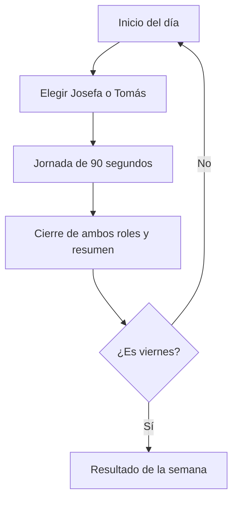
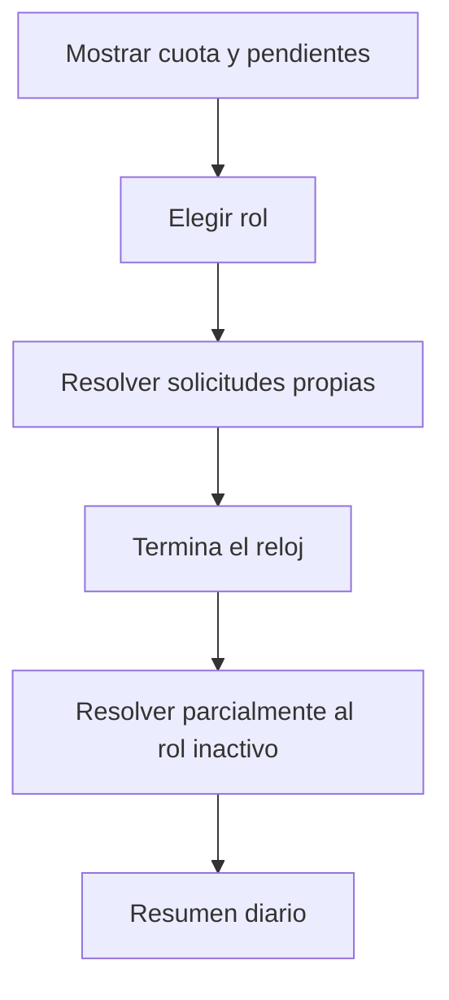
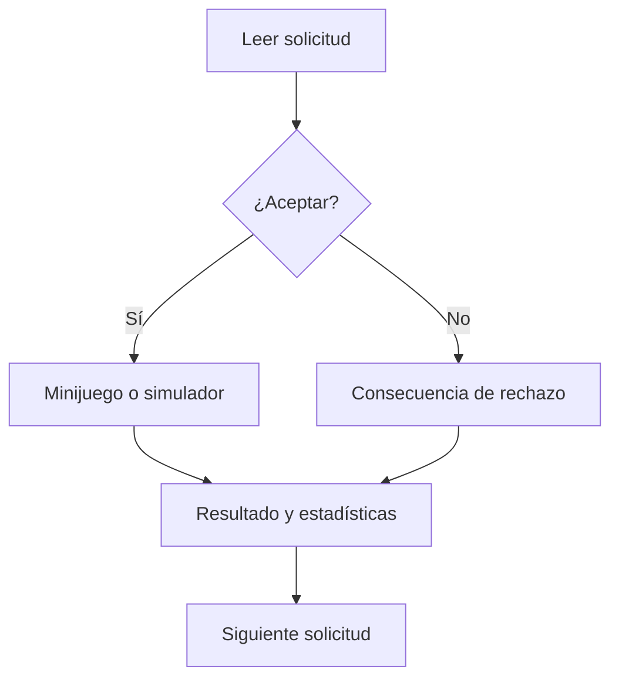
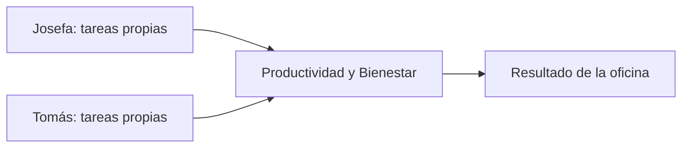
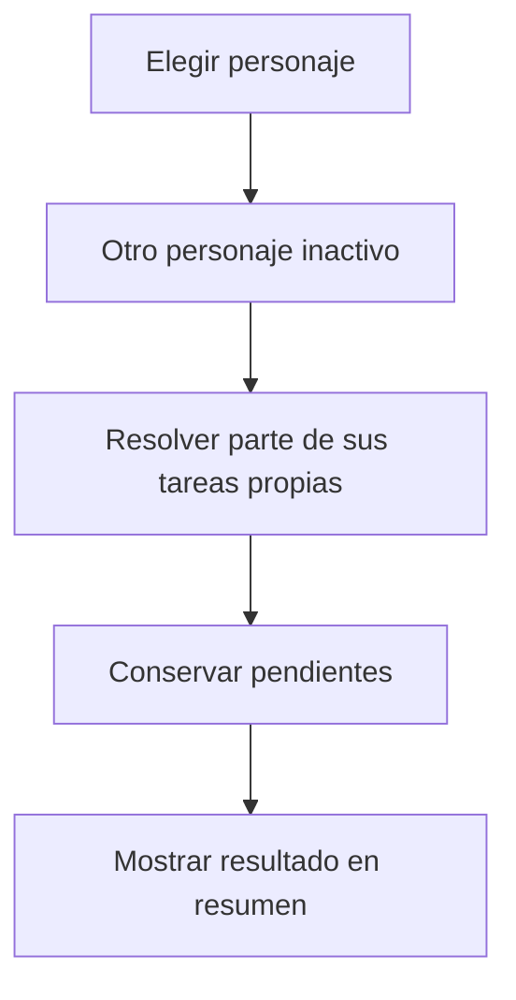
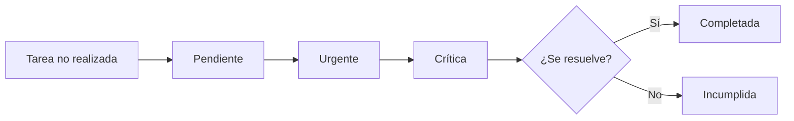
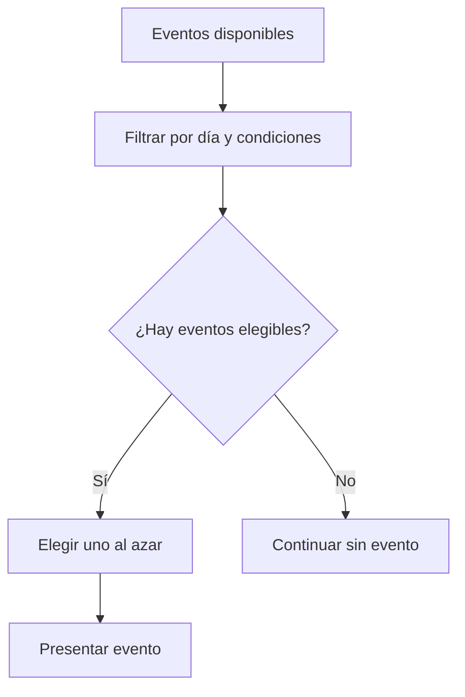
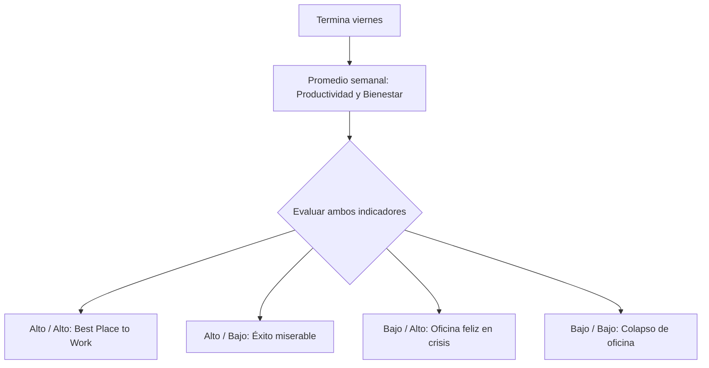

# DON'T MAKE ME MISERABLE — Game Design Document (MVP)

**Versión:** 2.5 — MVP para un jugador · Diagramas simplificados  
**Tipo:** Especificación de experiencia, alcance y mecánicas  
**Estado:** Dirección de diseño acordada; parámetros de balance preliminares  
**Contexto:** Game jam

---

> **Diagramas:** esquemas simplificados de las principales decisiones y secuencias del juego. Representan el diseño, no la arquitectura técnica.

## 1. Introducción

**Don't Make Me Miserable** es un juego de gestión narrativa de oficina para **un jugador**. Durante una semana laboral de **cinco jornadas**, el jugador escoge libremente, cada mañana, si vivirá ese día desde la perspectiva de **Josefa (jefa)** o **Tomás (trabajador)**. Ambos tienen **listas de tareas propias e independientes**, pero sus decisiones y desempeño afectan los dos indicadores comunes de la oficina: **Productividad** y **Bienestar**.

Cada jornada está limitada por un temporizador. El jugador selecciona solicitudes, decide **aceptarlas o rechazarlas** y, cuando corresponde, realiza un minijuego breve o utiliza la resolución simplificada de la tarea. El personaje no seleccionado sigue presente y **resuelve automáticamente una parte de sus propias tareas** mediante resultados guionizados sujetos al estado de la partida. Sus tareas no se transfieren ni se delegan al personaje activo.

Al cerrar el día se muestran el rendimiento, los cambios en los indicadores, los pendientes y las reacciones narrativas. Tras el viernes, el balance acumulado determina uno de **cuatro finales**.

**Fantasía central:** mantener una empresa a flote sin hacer miserable a quienes trabajan en ella, descubriendo cuándo comprometerse, cuándo poner límites y desde cuál perspectiva intervenir.

## 2. Objetivos de experiencia

1. **Elegir una perspectiva importa:** Josefa y Tomás ofrecen problemas, decisiones y minijuegos diferentes, sin que alternarlos sea obligatorio.
2. **Aceptar o rechazar son decisiones significativas:** decir que no puede ser acertado, pero ignorar sistemáticamente el trabajo necesario tiene consecuencias.
3. **Las consecuencias persisten:** la oficina y las listas de pendientes cambian de un día al siguiente; el jugador puede recuperar una mala semana.
4. **Narrativa y sistema se refuerzan:** diálogos y eventos muestran el impacto humano de los resultados.
5. **Partida breve, rejugable y legible:** cinco días, reglas comprensibles y un conjunto limitado de contenido reutilizable.

## 3. Premisas y decisiones cerradas

| Aspecto | Definición del MVP |
|---|---|
| Modo | Un jugador |
| Personajes | Josefa y Tomás; ambos siempre existen en la ficción y escena |
| Elección diaria | Libre, sin alternancia forzada, sin recomendación automática de rol |
| Semana | Lunes a viernes (5 jornadas) |
| Cierre de día | Temporizador, no número fijo de tareas |
| Información previa de solicitudes | Narrativa: sin mostrar recompensas/penalizaciones numéricas |
| Respuesta a solicitudes | Aceptar o rechazar; **no hay negociación como tercera opción** |
| Indicadores globales | Productividad y Bienestar |
| Tareas por personaje | **Independientes**; no existe flujo de delegación entre Josefa y Tomás |
| Personaje inactivo | **Modelo B:** resolución automática **parcial** de tareas propias, con reglas guionizadas condicionales |
| Trabajo pendiente | Listas propias por rol, persistentes y limitadas; aumenta su urgencia |
| Eventos narrativos | Selección semialeatoria entre eventos elegibles por condiciones |
| Minijuegos | Reutilizar los 6 existentes (3 por rol); otros trabajos usan el simulador existente |
| Resúmenes | Al final de cada día y al terminar la semana |
| Finales | Cuatro cuadrantes de Productividad × Bienestar |

## 4. Estructura de la partida (macro loop)

1. **Apertura del día.** Mostrar número de jornada, estado global de la oficina, cuota diaria, pendientes de **Josefa** y de **Tomás**, y contexto narrativo. Los problemas pueden describirse con pistas cualitativas, sin revelar modificadores exactos de las tareas.
2. **Elegir perspectiva.** El jugador elige Josefa o Tomás libremente. La elección dura **toda esa jornada**; no hay cambio de personaje a mitad del día.
3. **Jornada temporizada.** Se presentan las tareas propias del personaje elegido y, si corresponde, un evento especial. El jugador decide qué atender, acepta o rechaza y resuelve sus tareas.
4. **Actividad del personaje inactivo.** Sus tareas propias se gestionan mediante un guion condicional: completa **solo una parte** del trabajo disponible; el resto puede permanecer pendiente. No juega minijuegos en segundo plano.
5. **Cierre del día.** Resolver el trabajo aún abierto, calcular cuota y consecuencias, actualizar antigüedad de pendientes y mostrar qué hizo cada personaje.
6. **Resumen diario.** Mostrar estadísticas, trabajo completado, rechazos, pendientes, incumplimientos y una reacción narrativa contextual.
7. **Siguiente día o final.** Se repite el ciclo hasta el viernes. Al terminar la quinta jornada se calcula el balance semanal y se muestra uno de cuatro desenlaces.

### Diagrama — Loop semanal de la partida

En cada jornada se elige **solo un personaje**, pero el cierre incluye resultados de ambos. Las tareas permanecen separadas por rol.

### Diagrama — Secuencia de una jornada

La resolución del personaje inactivo aparece al cierre; la jornada activa dura por temporizador, no por completar un número fijo de tareas.

### Loop de una solicitud (micro loop)

**Leer situación → evaluar narrativamente → aceptar o rechazar → (si acepta) minijuego o simulador → resolver éxito/fracaso → actualizar trabajo, bienestar y pendientes → reacción breve → siguiente solicitud.**

El rendimiento en un minijuego **no sustituye** la decisión estratégica previa; completar una tarea puede perjudicar el Bienestar si suponía una sobrecarga.

### Diagrama — Decidir y resolver una solicitud

El rechazo **no es un fracaso automático**: su consecuencia depende de la solicitud. Aceptar tampoco concede productividad antes de resolver el trabajo.

## 5. Perspectivas jugables

### 5.1 Josefa — Jefatura

**Foco:** sus responsabilidades comerciales y administrativas, priorización de su trabajo, atención a clientes, gestión de plazos y decisiones sobre el ambiente laboral.

Ejemplos de solicitudes propias: responder clientes, organizar la agenda, aprobar solicitudes, asumir una urgencia comercial, tomar decisiones de bienestar.

- **Aceptar:** Josefa asume **su propia responsabilidad**; puede iniciar uno de sus minijuegos de gestión o una resolución simplificada. El resultado aporta trabajo realizado y puede tener efectos sobre el Bienestar.
- **Rechazar:** descarta, pospone o incumple **su propia solicitud**, según la naturaleza de esa tarea.
- **Riesgo característico:** aumentar resultados a costa de una gestión excesivamente exigente.

**No asigna las tareas jugables de Tomás.** Ambos pueden verse afectados por decisiones de gestión de la oficina, pero no existe una cadena de «Josefa asigna hoy → Tomás ejecuta mañana».

### 5.2 Tomás — Trabajador

**Foco:** sus tareas operativas, carga laboral, ejecución de trabajos y límites frente a solicitudes injustificadas.

Ejemplos de solicitudes propias: reparar cables, limpiar correos, usar la fotocopiadora, cubrir una ausencia, decidir ante una solicitud de horas extras.

- **Aceptar:** asume **su propia tarea** y realiza su minijuego o resolución simplificada.
- **Rechazar:** evita una carga inmediata; la consecuencia depende de si era trabajo imprescindible, opcional o abusivo.
- **Riesgo característico:** trabajar de más y erosionar el Bienestar, o dejar demasiadas obligaciones sin atender.

### 5.3 Elección de rol: libertad real

- Es válido escoger el **mismo rol los cinco días**.
- No hay bonificación artificial por alternar ni recomendación de cuál elegir.
- La ventaja de cambiar debe surgir del **estado de cada lista de tareas**, la urgencia de sus pendientes, las situaciones disponibles y la diferente capacidad de resolución directa frente a automática.
- El jugador puede consultar **ambos conjuntos de pendientes antes de elegir**, para que su decisión sea informada.

### Diagrama — Responsabilidades separadas, resultado compartido

**No existe una flecha de delegación entre roles:** ninguna tarea de Josefa se convierte en trabajo jugable de Tomás, ni viceversa.

## 6. Personaje inactivo — Modelo B

El personaje no elegido **continúa atendiendo sus propias responsabilidades**, pero solo resuelve **una parte** de ellas. Su actividad se calcula con reglas guionizadas **condicionadas por indicadores y estado de pendientes**, no con IA ni con una segunda sesión de juego activa.

**Reglas de principio:**

1. Cada rol tiene su **propia bandeja y lista de pendientes**. Nunca se transfieren tareas entre roles.
2. El personaje inactivo resuelve una cantidad limitada de trabajo de **su propia lista**, según condiciones conocidas de la oficina.
3. Algunas tareas no atendidas permanecen pendientes y envejecen; las que caducan generan consecuencias.
4. El rendimiento automático no debe equivaler siempre al control directo ni ser tan débil que obligue a alternar diariamente.
5. Los resultados se comunican explícitamente en el resumen, idealmente con una frase narrativa: «Tomás atendió una solicitud; otra quedó sin resolver».
6. No se crean nuevos trabajos inesperados al cierre solo para penalizar al jugador: los sucesos relevantes deben proceder de la lista y/o de eventos elegibles del día.

**Ejemplo ilustrativo:** el lunes se juega con Josefa. Tomás tiene dos tareas operativas independientes. El guion condicional resuelve una y deja la otra pendiente. El martes se puede elegir a Tomás para atender ese trabajo directamente, **o** volver a jugar como Josefa y dejar que el guion de Tomás continúe. Ambas rutas deben ser viables, aunque con consecuencias diferentes.

**Balance provisional, no cerrado:** la capacidad automática podría variar entre **0 y 2 tareas diarias por personaje**, de acuerdo con condiciones narrativas y estadísticas. El valor específico y la forma de resolver la cuota necesitan playtest; no se presume que Josefa y Tomás usen la misma fórmula.

### Diagrama — Modelo B: personaje no elegido

La capacidad no implica resolver siempre todas las tareas; el personaje inactivo **tampoco acepta ni ejecuta trabajos del activo**.

## 7. Tareas: aceptación, rechazo y resolución

### 7.1 Información al jugador

La ficha previa a la decisión muestra:

- Un **título claro** de la solicitud.
- **Quién la solicita / qué ocurre** y por qué importa.
- Pistas textuales de **urgencia, esfuerzo y consecuencias** («el cliente espera hoy», «tendrá que hacerse mañana», «implicaría quedarse fuera de horario»).
- Las acciones **Aceptar** y **Rechazar**.

**No se muestran números de Productividad o Bienestar antes de elegir.** Las consecuencias, sin embargo, no deben sentirse aleatorias: la escritura proporciona señales consistentes. El resultado cuantitativo sí puede mostrarse después, en feedback o resumen.

### 7.2 Categorías internas

| Tipo de tarea | Si se acepta | Si se rechaza |
|---|---|---|
| **Necesaria** | Se intenta resolver; puede aportar cuota | Queda pendiente si corresponde, envejece y puede incumplirse |
| **Opcional** | Oportunidad de trabajo adicional | Se pierde esa oportunidad, sin castigo directo automático |
| **Abusiva / sobrecarga** | Puede rendir trabajo, pero con alto coste de Bienestar | Evita la sobrecarga y no crea pendiente; algunos casos recuperan Bienestar |

La categoría puede permanecer oculta en la UI, pero debe poder inferirse de la narrativa. Rechazar no otorga Bienestar por defecto: solo lo hacen situaciones justificadas.

### 7.3 Éxito, fracaso y simulador

- Un **minijuego exitoso** resuelve la tarea según su valor de trabajo y efectos narrativos.
- Un **minijuego fallido** no debería premiar como un éxito; la solicitud puede seguir pendiente o perderse según su tipo, con consecuencias definidas.
- Las tareas sin minijuego usan el **simulador/resolución simplificada existente**. Su rendimiento debe ser comparable y coherente con el coste de atención, sin superar sistemáticamente al minijuego.
- El mismo trabajo **no puede otorgar puntos dos veces** (por aceptar y por terminar).

## 8. Dos indicadores compartidos

### Productividad (0–100)

Representa el rendimiento global sostenido de la oficina. **No es lo mismo que la cuota diaria.** La cuota mide unidades de trabajo efectivamente resueltas durante esa jornada por ambos roles; la Productividad se actualiza al cierre de acuerdo con el desempeño del día.

### Bienestar (0–100)

Representa el estado general del ambiente de trabajo. Cambia por sobrecarga, decisiones laborales, eventos, tareas especiales y sus resultados. Los costos y beneficios deben justificarse narrativamente.

### Variables operativas, no nuevos indicadores globales

- **Cuota diaria:** objetivo de unidades de trabajo completado.
- **Trabajo realizado hoy:** suma de lo resuelto por el personaje activo y el inactivo; se contabiliza una sola vez.
- **Pendientes por personaje:** bandejas separadas con límite de capacidad y antigüedad.
- **Temporizador:** tiempo restante del día.

### Balance de referencia para primera prueba (no aprobado como definitivo)

| Parámetro | Valor de referencia |
|---|---:|
| Productividad / Bienestar inicial | 50 / 50 |
| Jornada | 90 segundos |
| Cuota conjunta diaria | 20 unidades |
| Pendientes máximos | 3 **por personaje** (propuesta coherente con las bandejas independientes) |
| Vida de pendiente | Edad 0 → 1 → 2 → incumplimiento |
| Eventos especiales | Hasta 1 por día |

**Propuesta de conversión de cuota a Productividad:** 20 o más unidades = +6; 15–19 = +2; 10–14 = -4; 0–9 = -8. Se aplica **una sola vez al cierre del día**, sin duplicar la contribución de tareas.

**Efectos ilustrativos de Bienestar:** tarea normal completada -3; tarea urgente -6; horas extras -12; rechazo de tarea opcional 0; rechazo de sobrecarga abusiva +5; actividad de bienestar +8; fracaso bajo presión -3 adicionales; incumplimiento crítico -5. Los efectos deben asociarse a causas inequívocas para no castigar dos veces un mismo hecho.

**Aclaración de balance importante:** como ahora **ambos personajes producen trabajo por separado cada día**, la cuota conjunta de 20 y la capacidad automática se deben calibrar conjuntamente. No están validadas y podrían permitir cumplir cuota sin jugar o volverla imposible; no se asumen definitivas.

## 9. Pendientes por personaje y urgencia

Los pendientes son **propios de cada rol**. Una tarea de Josefa nunca se transforma en una tarea de Tomás, ni al terminar el día ni por cambiar de perspectiva.

| Estado | Regla provisional |
|---|---|
| **Edad 0** | Queda pendiente al cierre inicial |
| **Edad 1** | Aparece urgente al día siguiente |
| **Edad 2** | Es crítica; última jornada para atenderla |
| **Incumplida** | Tras agotar su plazo, sale de la cola y aplica una consecuencia una sola vez |

- Las tareas **opcionales** normalmente se pierden al rechazarse; las **abusivas** no generan pendientes por un rechazo.
- Las **necesarias** pueden pasar a la bandeja del personaje que las recibió, dentro del límite.
- Si la bandeja del rol está llena y otra obligación queda sin resolver, se registra un incumplimiento o consecuencia específica; **no se envía al otro personaje**.
- Se debe advertir narrativamente sobre tareas críticas y saturación, sin exponer números ocultos de balance.
- La antigüedad se actualiza en un punto consistente del cambio de jornada, evitando envejecer dos veces.

### Diagrama — Ciclo de vida de un pendiente por rol

Cada bandeja corresponde exclusivamente a su personaje. La capacidad, el envejecimiento y el incumplimiento se evalúan **una sola vez por transición pertinente**. Las solicitudes opcionales o abusivas rechazadas no recorren este ciclo.

## 10. Temporizador y ritmo diario

**Duración inicial propuesta:** 90 segundos por jornada.

| Momento | ¿Corre el reloj? |
|---|---|
| Resumen previo y elección de rol | No |
| Lectura y elección dentro de la jornada | Sí |
| Ejecución del minijuego o simulador | Sí |
| Diálogo narrativo obligatorio | No |
| Resumen y transición | No |

No hay recompensa numérica adicional por segundos restantes. Actuar rápido solo permite atender más solicitudes disponibles. Si no quedan solicitudes, se puede cerrar el día antes.

Cuando el tiempo llega a cero, no se permite iniciar nuevas tareas. Las actividades en curso deben tener un resultado consistente y visible. Este detalle necesita una regla final tras probar la duración de los minijuegos: evitar ventanas imposibles de terminar por falta de tiempo restante.

## 11. Eventos narrativos semialeatorios y diálogos

**Selección:** filtrar primero eventos por día, condiciones globales, rol, antecedentes y unicidad; escoger aleatoriamente entre los elegibles. Si ninguno aplica, no forzar un evento incoherente.

**Material reutilizable del documento narrativo original:** urgencias de clientes, sustitución de un colega enfermo, averías de impresora/computador, horas extras, pausa activa, gatitos en la oficina y corte de luz. Se adaptan a la perspectiva pertinente; **no obligan a transferir tareas entre Josefa y Tomás**.

**Los diálogos pueden aparecer** al abrir una jornada, aceptar o rechazar tareas, triunfar o fallar en minijuegos, alcanzar condiciones relevantes de Bienestar/Productividad, entrar en estado crítico de pendientes, cerrar un día o terminar la semana.

**Personajes:** solamente Josefa y Tomás tienen presencia protagónica; otros empleados o clientes pueden ser mencionados en texto sin convertirse en personajes jugables.

**Tono narrativo:** humor laboral, ironía y consecuencias comprensibles, recuperando la temática de *Don't Make Me Miserable*: gestionar trabajo y salud mental sin convertir «decir que no» en una decisión automáticamente mala.

### Diagrama — Selección semialeatoria de eventos

La aleatoriedad afecta **qué situación elegible aparece**, no inventa resultados ajenos a las reglas ni fuerza eventos incoherentes.

### Textos reutilizables

Se conservan, adaptándolos a Don't Make Me Miserable y a la perspectiva elegida, los diálogos de Josefa y Tomás, los cierres por cuadrante de Productividad/Bienestar y los cuatro desenlaces disponibles en el documento narrativo. Algunas líneas originales presuponen control simultáneo de jefatura y trabajador o que el jugador siempre es jefe; deben entenderse como material a adaptar, no texto final inalterable.

## 12. Minijuegos y contenido del MVP

**Seis minijuegos existentes**, asociados a las tareas de cada rol:

| Josefa (jefa) | Tomás (trabajador) |
|---|---|
| Asignar documentos | Conectar cables |
| Agenda imposible | Limpiar correos |
| Aprobación express | Fotocopiadora infernal |

Son actividades breves, presentadas en **ventanas emergentes** y resueltas con controles de un solo jugador. El juego mantiene el catálogo conocido de **8 tareas** como punto de partida: actualmente tres vinculadas a minijuegos y las otras con resolución de simulador, según el estado reportado del proyecto. **No se requiere ampliar el número de minijuegos para este MVP.**

Las tareas nuevas o históricas se usan solo cuando encajan con el rol; no se interpreta que una pareja de minijuegos represente una delegación de Josefa a Tomás.

## 13. Presentación visual y UX

Se mantiene la identidad visual de las capturas del prototipo anterior:

- **Pixel art y retratos ilustrados** de Josefa y Tomás.
- **Paleta lila** asociada a Josefa y **verde** asociada a Tomás, con fondos pastel y oscuros.
- **Oficinas de ambos personajes presentes**; la perspectiva elegida recibe el énfasis visual y los controles del día.
- **Ventanas emergentes estilo escritorio/sistema operativo** para solicitudes y minijuegos.
- Iconografía existente de **Bienestar y Productividad**.
- Pantallas de introducción de día, selección por expedientes, resúmenes y finales reutilizadas conceptualmente.

La antigua pantalla de **seleccionar un jefe y un empleado una sola vez** se interpreta en el nuevo juego como **elegir entre Josefa o Tomás al inicio de cada día**. El personaje inactivo permanece visible, pero no demanda controles del segundo jugador.

**Claridad visual mínima:** mostrar jornada y tiempo restante, rol elegido, Productividad y Bienestar, cuota diaria, tareas disponibles y pendientes diferenciados por personaje. Las recompensas exactas se reservan para el resultado/resumen, no la ficha previa.

## 14. Resumen diario y finales

### Cierre diario

Debe responder: **¿qué logré, qué sacrificó la oficina y qué queda para mañana?**

Presentar:

- Día y rol controlado.
- Cuota y unidades completadas **por ambos roles**.
- Cambios del día y valores actuales de Productividad y Bienestar.
- Tareas aceptadas, rechazadas, completadas, fallidas e incumplidas.
- Pendientes propios de Josefa y de Tomás, con urgencia.
- Una síntesis legible del **trabajo automático parcial** del personaje inactivo.
- Un diálogo o comentario de cierre condicionado por el estado.

### Resumen semanal

Tras el viernes se muestran la evolución de los indicadores, el balance de la semana y **uno de cuatro finales narrativos**:

| Productividad | Bienestar | Final |
|---|---|---|
| Alta | Alto | **Best Place to Work** |
| Alta | Bajo | **Éxito miserable** |
| Baja | Alto | **Oficina feliz, empresa en crisis** |
| Baja | Bajo | **Colapso de la oficina** |

**Criterio numérico inicial propuesto:** promedio de los valores de cierre de Productividad y Bienestar de los cinco días, con umbral 50 para considerar «alto». Se usa el recorrido semanal, no solo el valor del viernes. Requiere validación de balance.

### Diagrama — Evaluación del final semanal

Los valores de corte propuestos para «alto» son preliminares, igual que el promedio semanal como criterio del desenlace.

## 15. Límites de alcance del MVP

### Dentro del alcance

- Una semana de cinco jornadas para un jugador.
- Selección diaria libre entre **dos personajes fijos**.
- Dos indicadores globales.
- Catálogos de tareas **independientes** por rol.
- Aceptar y rechazar con consecuencias narrativas.
- Minijuegos existentes y resolución simplificada para el resto.
- Temporizador diario, cuotas conjuntas y pendientes separados con urgencia.
- Personaje inactivo con **resolución parcial guionizada y condicional**.
- Eventos narrativos semialeatorios, diálogos breves, resumen diario y cuatro desenlaces.
- Reutilización de arte y componentes visuales ya producidos.

### Fuera del alcance

- Multijugador simultáneo, controles compartidos y competición entre dos personas.
- Delegación o traspaso de tareas entre Josefa y Tomás.
- Cambio de personaje durante una misma jornada.
- Árbol de negociación como tercera respuesta estándar.
- Nuevas estadísticas globales de estrés, dinero, reputación o ánimo individual.
- IA compleja o simulación continua de oficina.
- Nuevos personajes jugables, gestión individual de empleados secundarios o sistemas de progresión permanentes.
- Nuevos minijuegos obligatorios o ampliación significativa del catálogo para completar el MVP.

## 16. Criterios de experiencia del MVP

El núcleo jugable estará suficientemente definido cuando una partida pueda sentirse coherente bajo estas situaciones:

- Elegir siempre a Josefa o siempre a Tomás **sigue siendo posible**, pero expone diferencias y riesgos.
- Cambiar de personaje ofrece control directo sobre **sus propios pendientes**, no sobre trabajos delegados por el otro.
- Rechazar todo reduce el trabajo completado y puede hacer envejecer obligaciones, pero no castiga arbitrariamente un rechazo justificado.
- Aceptar todo puede cumplir cuotas a costa del Bienestar.
- El jugador entiende mediante contexto narrativo **por qué** una tarea era urgente o abusiva.
- El resultado automático del personaje inactivo es visible, explicable y limitado.
- Hay oportunidades de recuperar una situación negativa antes del viernes.
- Los finales reflejan el equilibrio o desequilibrio acumulado durante la semana.

## 17. Parámetros aún sujetos a balance (no son nuevas decisiones de alcance)

Los siguientes valores **no están cerrados**: 90 segundos por día, cuota de 20 unidades, capacidad exacta de pendientes **por personaje**, capacidad automática del rol inactivo, efectos numéricos de las tareas y umbral de los finales. Son hipótesis de prueba, no instrucciones definitivas de implementación.

**Regla rectora:** cualquier ajuste debe mantener separadas las tareas de Josefa y Tomás, conservar la elección diaria libre y hacer que **la tensión entre Productividad y Bienestar** nazca de decisiones comprensibles, no de resultados arbitrarios.

---

**Síntesis del MVP:** *Cinco días. Dos perspectivas. Dos indicadores. Responsabilidades independientes, consecuencias compartidas. Elige a quién controlar hoy y decide qué trabajo vale la pena hacer.*
